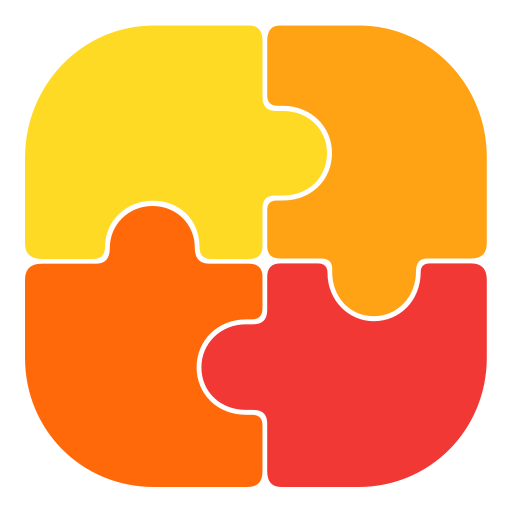
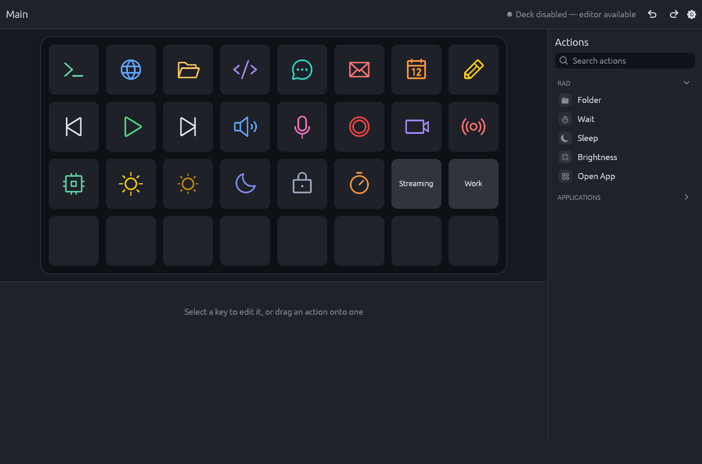
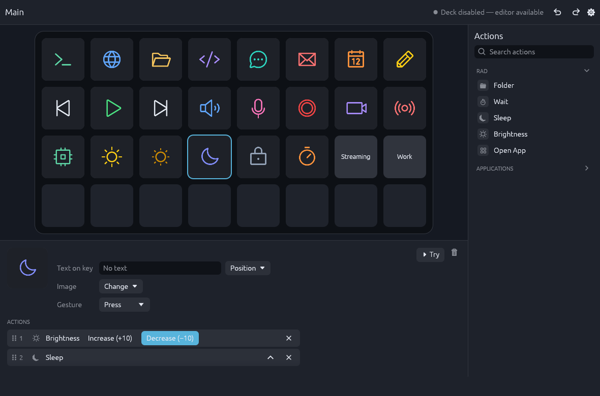
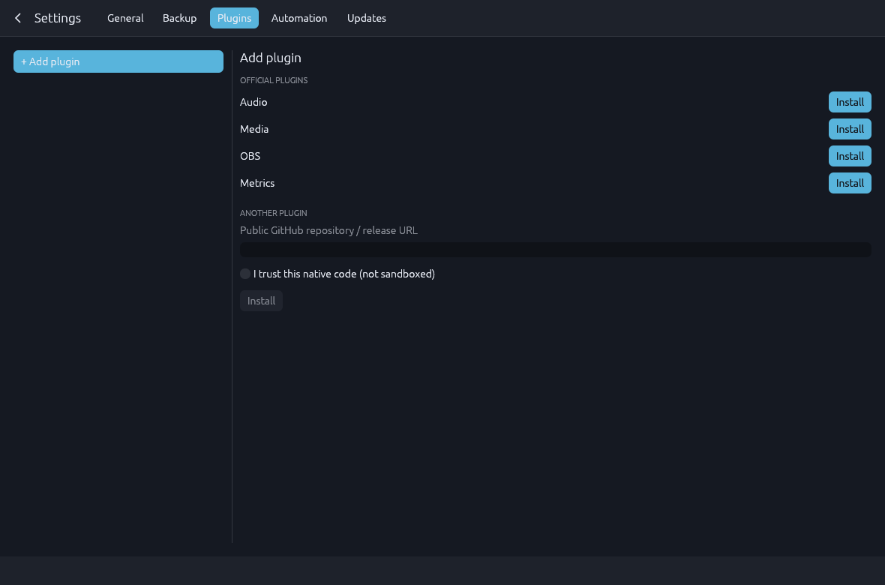

[English](README.md) · [Español](README.es.md)

<p align="center"></p>

# RAD · Rust Action Deck

Un editor nativo para Linux y un runtime local para tu Stream Deck.



## ¿Qué es RAD?

RAD convierte un Stream Deck XL en un lanzador de aplicaciones y una superficie
de control para tu escritorio. Organiza teclas visualmente, agrúpalas en carpetas
y combina acciones. El deck sigue funcionando al cerrar el editor.

## Funciones

- Distribución de 32 teclas con carpetas, arrastrar y soltar, y deshacer/rehacer.
- Hasta 20 acciones por tecla, en secuencia o en paralelo.
- Aplicaciones del catálogo del escritorio, abiertas con una tecla.
- Texto propio, imágenes PNG/JPEG y una biblioteca de iconos integrada.
- Plugins opcionales de audio, multimedia, OBS y métricas del sistema, cargados
  solo cuando hacen falta.
- Copias de respaldo sin credenciales y una CLI local para automatizar.
- Interfaz en inglés y español.

| Editar una tecla | Añadir plugins |
| --- | --- |
|  |  |

Las capturas usan una configuración demo.

## Instalar

RAD se distribuye como el paquete Arch `rust-action-deck`, construido para
**Omarchy 4.0.6 x86-64**. Descarga el archivo `.pkg.tar.zst` de la
[última release](https://github.com/KroxiDev/RAD/releases/latest) e instálalo:

```bash
sudo pacman -U ./rust-action-deck-<version>-<pkgrel>-x86_64.pkg.tar.zst
```

Tamaño instalado: **unos 50 MB** (editor, runtime, bandeja, CLI y actualizador).
Los plugins se instalan aparte, desde el editor. Abre RAD desde el menú de
aplicaciones y activa **Usar el Stream Deck con RAD** en Ajustes.

Para actualizar, ve a **Ajustes → Actualizaciones → Verificar actualizaciones**;
RAD nunca lo comprueba por su cuenta. Las actualizaciones vienen de las releases
oficiales de GitHub por HTTPS, sin una firma de paquete independiente. Detalles:
[empaquetado y recuperación](packaging/README.md).

Requisitos:

- Linux con Wayland y un driver compatible con OpenGL.
- Acceso de lectura/escritura al dispositivo `hidraw` del Stream Deck. Muchas
  distribuciones se lo conceden a la sesión activa mediante `uaccess`.
- Ninguna otra aplicación de Stream Deck abierta al mismo tiempo.

## Plugins

| Plugin | Controles | Necesita |
| --- | --- | --- |
| Audio | Silenciar salida y micrófono, con indicador de estado | `pactl` |
| Multimedia | Controles de reproducción y reproducción actual | Un reproductor MPRIS |
| OBS | Escena Program, filtros, elementos, grabación y transmisión | OBS Studio con su servidor WebSocket activo |
| Métricas | CPU, RAM, GPU y VRAM | GPU/VRAM: driver NVIDIA con NVML |

Instálalos desde **Ajustes → Plugins → + Añadir plugin**; el editor ofrece
**Actualizar** cuando sale una release nueva. Las releases están en
[KroxiDev/rad-plugins](https://github.com/KroxiDev/rad-plugins). También puedes
pegar la URL pública de release de GitHub de otro plugin. Los plugins son procesos
nativos, **no un sandbox de seguridad**: instala solo código en el que confíes.
Para escribir uno, consulta la [guía para autores](plugins/README.md).

## Tus datos

La configuración vive en `$XDG_DATA_HOME/rad` (normalmente `~/.local/share/rad`).
**Ajustes → Respaldo → Exportar copia** guarda una copia en `~/RAD Backups`; las
copias excluyen credenciales y programas de plugins. Cerrar el editor deja el deck
funcionando; **Salir de RAD** en el icono de la bandeja lo detiene todo.

## Compilar desde el código fuente

Necesitas un Rust reciente con la edición 2024. Desde la raíz del repositorio:

```bash
CARGO_HOME="$PWD/target/cargo-home" cargo fetch --locked  # solo la primera vez, requiere red
make up       # compila en modo release
make up-full  # compila y abre el editor
```

Los binarios quedan en `target/release`. La primera vez, abre `rad-editor` desde
ahí: añade RAD al menú de aplicaciones y arranca el runtime como servicio systemd
de usuario. Sal de RAD desde la bandeja antes de recompilar para que el siguiente
arranque use los binarios nuevos. Para probar un cambio sin tocar el RAD instalado
ni sus datos, ejecuta `bash scripts/dev-run.sh` ([cómo funciona](docs/testing.md#probar-a-mano)).

## Cómo funciona

```text
Editor / rad-cli ↔ socket Unix local ↔ Runtime ↔ Stream Deck (hidraw)
                                         ↕
                                  Procesos de plugins
```

El runtime posee la configuración, la ejecución, la navegación y el dispositivo.
El editor y la CLI son clientes suyos, y cada plugin activo corre en su propio proceso.

## Desarrollo

Empieza por [CONTRIBUTING.md](CONTRIBUTING.md) y el
[índice de documentación técnica](docs/README.md), cuyo idioma canónico es el
español. La [guía de validación](docs/testing.md) describe el gate completo de
tests. Los agentes también deben seguir [AGENTS.md](AGENTS.md).

## Estado

Probado con un Stream Deck XL en Omarchy/Hyprland. Otros modelos de dispositivo y
distribuciones Linux no están validados.

## Licencia

[MIT](LICENSE), copyright KroxiDev. Las dependencias conservan sus licencias;
consulta las [licencias de terceros](plugins/notices/README.md) de los plugins.
