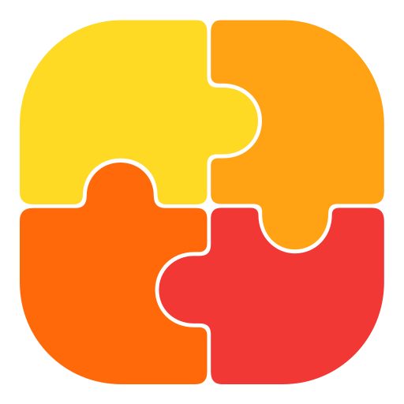
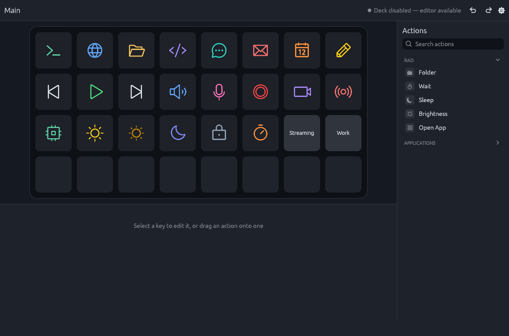
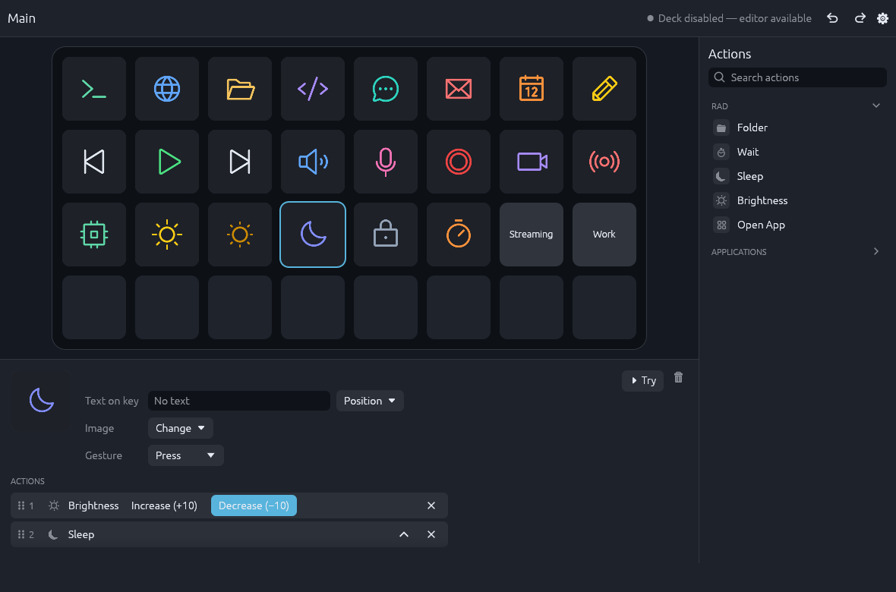
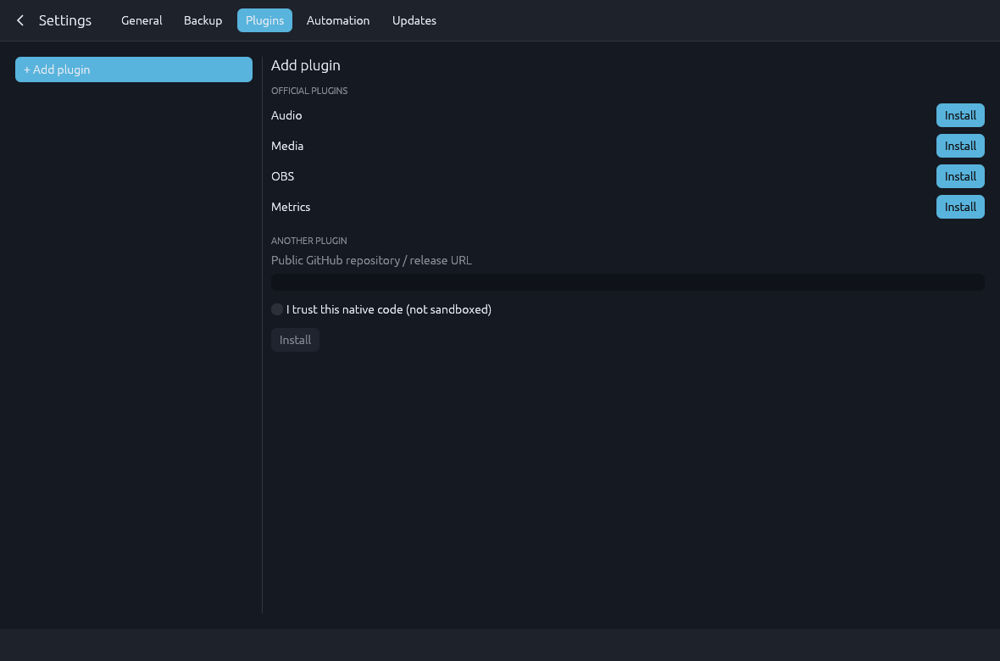

[English](README.md) · [Español](README.es.md)

<p align="center"></p>

# RAD · Rust Action Deck

A native Linux editor and local runtime for your Stream Deck.



## What is RAD?

RAD turns a Stream Deck XL into an application launcher and control surface for
your desktop. Arrange keys visually, group them into folders and combine actions.
The deck keeps working when the editor is closed.

## Features

- A 32-key layout with folders, drag and drop, and undo/redo.
- Up to 20 actions per key, run in sequence or in parallel.
- Applications from your desktop's catalog, opened with one key.
- Custom text, PNG/JPEG images and a built-in icon library.
- Optional audio, media, OBS and system-metrics plugins, loaded only when needed.
- Backups that exclude credentials, and a local CLI for automation.
- English and Spanish interface.

| Edit a key | Add plugins |
| --- | --- |
|  |  |

Screenshots use a demo configuration.

## Install

RAD ships as the Arch package `rust-action-deck`, built for **Omarchy 4.0.6
x86-64**. Download the `.pkg.tar.zst` file from the
[latest release](https://github.com/KroxiDev/RAD/releases/latest) and install it:

```bash
sudo pacman -U ./rust-action-deck-<version>-<pkgrel>-x86_64.pkg.tar.zst
```

Installed size: **about 50 MB** (editor, runtime, tray, CLI and updater). Plugins
are installed separately, from the editor. Open RAD from the applications menu and
turn on **Use the Stream Deck with RAD** in Settings.

To update, go to **Settings → Updates → Check for updates**; RAD never checks on
its own. Updates come from the official GitHub releases over HTTPS, without a
separate package signature. Details: [packaging and recovery](packaging/README.md).

Requirements:

- Linux with Wayland and an OpenGL-capable driver.
- Read/write access to the Stream Deck's `hidraw` device. Many distributions grant
  it to the active session through `uaccess`.
- No other Stream Deck app running at the same time.

## Plugins

| Plugin | Controls | Needs |
| --- | --- | --- |
| Audio | Output and microphone mute, with status | `pactl` |
| Media | Playback controls and now playing | An MPRIS player |
| OBS | Program scene, filters, scene items, recording and streaming | OBS Studio with its WebSocket server on |
| Metrics | CPU, RAM, GPU and VRAM | GPU/VRAM: NVIDIA driver with NVML |

Install them from **Settings → Plugins → + Add plugin**; the editor offers
**Update** when a new release is out. Releases live in
[KroxiDev/rad-plugins](https://github.com/KroxiDev/rad-plugins). You can also
paste the public GitHub release URL of another plugin. Plugins run as native
processes, **not in a security sandbox**: install only code you trust. To write
one, see the [plugin author guide](plugins/README.md).

## Your data

Configuration lives in `$XDG_DATA_HOME/rad` (usually `~/.local/share/rad`).
**Settings → Backup → Export Backup** saves a copy to `~/RAD Backups`; copies
exclude credentials and plugin programs. Closing the editor leaves the deck
working; **Quit RAD** in the tray icon stops everything.

## Build from source

You need a recent Rust toolchain with edition 2024. From the repository root:

```bash
CARGO_HOME="$PWD/target/cargo-home" cargo fetch --locked  # first time only, needs network
make up       # build in release mode
make up-full  # build, then open the editor
```

Binaries land in `target/release`. The first time, open `rad-editor` from there:
it adds RAD to the applications menu and starts the runtime as a systemd user
service. Quit RAD from the tray before rebuilding so the next launch uses the new
binaries. To try a change without touching your installed RAD or its data, run
`bash scripts/dev-run.sh` ([how it works](docs/testing.md#probar-a-mano)).

## How it works

```text
Editor / rad-cli ↔ local Unix socket ↔ Runtime ↔ Stream Deck (hidraw)
                                         ↕
                                  Plugin processes
```

The runtime owns configuration, execution, navigation and the device. The editor
and the CLI are clients of it, and each active plugin runs in its own process.

## Development

Start with [CONTRIBUTING.md](CONTRIBUTING.md) and the
[technical documentation index](docs/README.md) (canonical language: Spanish).
The [validation guide](docs/testing.md) describes the full test gate. Agents must
also follow [AGENTS.md](AGENTS.md).

## Status

Tested with one Stream Deck XL on Omarchy/Hyprland. Other device models and Linux
distributions are not validated.

## License

[MIT](LICENSE), copyright KroxiDev. Dependencies retain their own licenses;
see the plugins' [third-party notices](plugins/notices/README.md).
