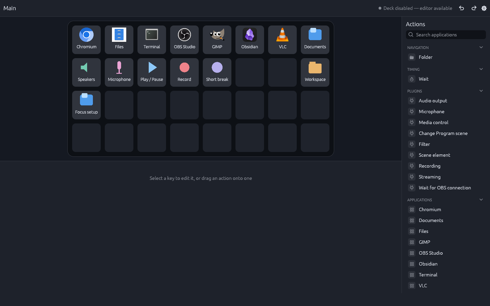
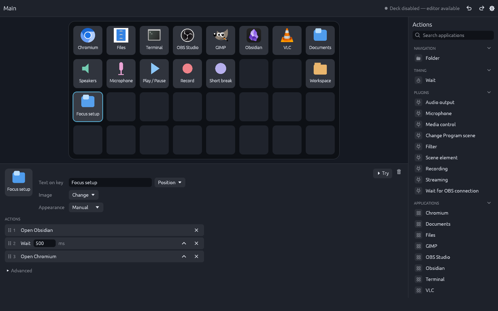
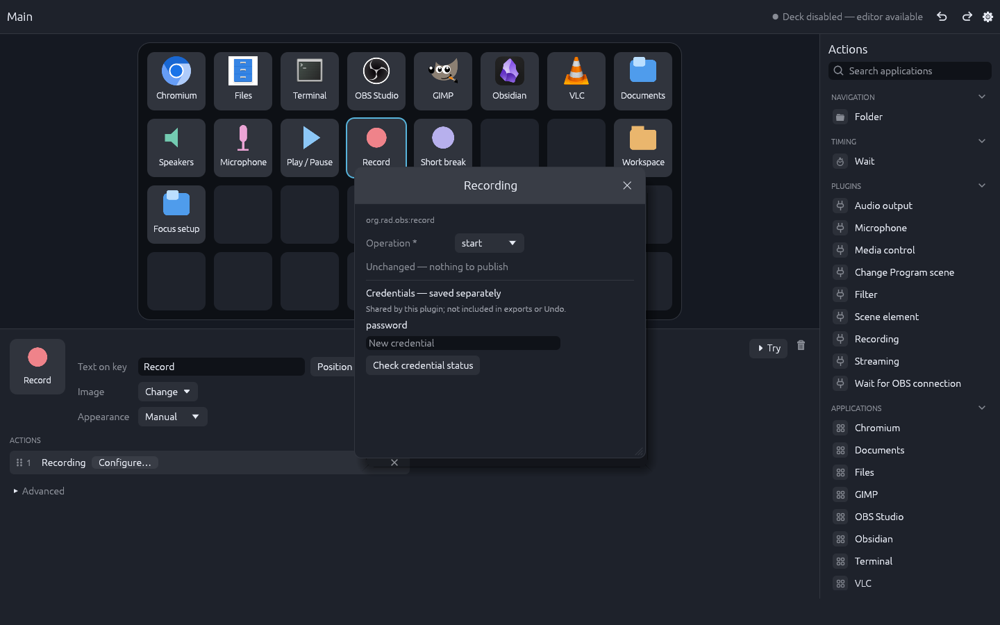
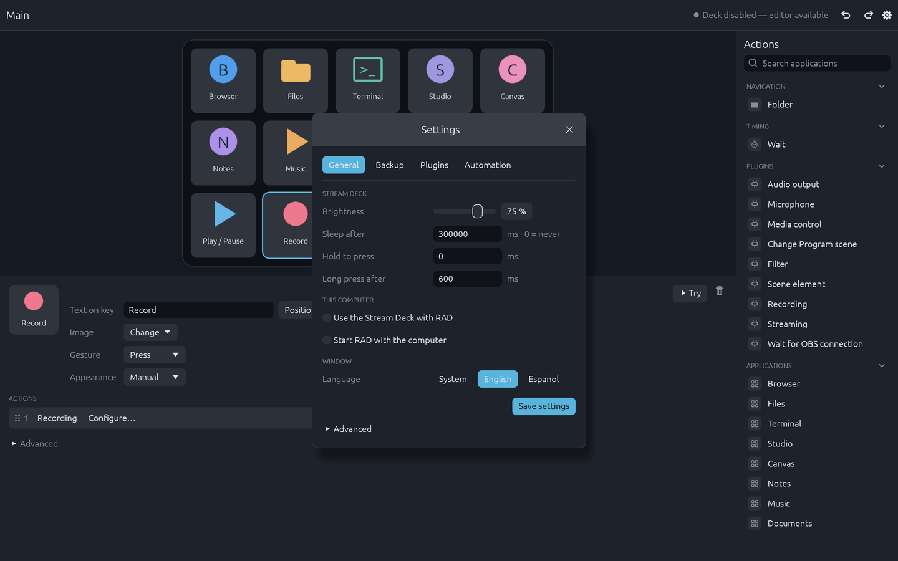

[English](README.md) · [Español](README.es.md)

# RAD · Rust Action Deck

A native Linux editor and local runtime for your Stream Deck.



## What is RAD?

RAD turns a Stream Deck XL into a configurable application launcher and control
surface. Arrange buttons visually, organize them into folders, and combine actions.
The runtime keeps working when the editor is closed.

## Features

- A 32-key layout, folders, drag-and-drop editing and undo/redo.
- Up to 20 actions per button, sequential or parallel execution, and built-in Wait
  and Sleep actions.
- Application launching from your desktop's application catalog.
- Custom labels and static PNG/JPEG images.
- English and Spanish UI; brightness, idle and press-threshold settings.
- Configuration export/restore. Exports exclude credentials and plugin executables.
- Local CLI automation with inherited query, modify and execute permissions.
- Optional audio, media, OBS and system-metrics plugins.
- Official plugins load on demand and sleep when nothing needs them. Visible
  buttons, queries and accepted work can keep them active—not just key presses.

## Gallery

| Key inspector | Plugin action |
| --- | --- |
|  |  |



Screenshots use a demo configuration.

## Requirements

- Linux with Wayland and an OpenGL-capable driver. A recent Rust toolchain
  supporting edition 2024 is needed only for source builds.
- Read/write access to the Stream Deck's `hidraw` node. Distributions with the
  systemd audiovisual-controller hwdb and udev rules can grant active-session
  access through `uaccess`; check your distribution's device permissions.
- Audio: `pactl`. Media: an MPRIS player on the session D-Bus.
- GPU/VRAM metrics: the NVIDIA driver with NVML. CPU/RAM do not require NVIDIA.
- OBS: local OBS Studio with its WebSocket server enabled.
- Tests: `bwrap`, `pactl`, `dbus-daemon` and Linux namespace support.

## Binary packages and updates

Arch binary-package tooling targets **Omarchy 4.0.6 x86-64** as `rust-action-deck`.
A published, verified stable release is not implied by the presence of that tooling;
see the [distribution status and procedure](packaging/README.md).
The package includes the editor, runtime, tray, launcher helper, CLI and updater;
Rust is required to build it, not to use a precompiled package.

Updates are checked only when you click **Check for updates** in **Settings → Updates**.
Only stable official `KroxiDev/RAD` releases are eligible. A supported package
installation offers **Update RAD** for a newer version; it downloads and verifies
before stopping RAD, asks for system authorization and reopens the editor.
There are no startup checks, tray notifications or automatic installations.
Development checkouts cannot replace the system installation through this flow.
The trust model is the official GitHub origin over HTTPS, **not an independent
package signature**; pacman's configured signature checks are never disabled.
Keep a private backup before testing installation/removal; portable RAD exports
exclude credentials. See [installation and recovery](packaging/README.md#retirar-reinstalar-y-recuperar).

## Build and run

With GNU Make, from the repository root:

```bash
make up       # Build the application in release mode without opening it
make up-full  # Build and open the editor only if the build succeeds
```

These shortcuts build the application, not plugins, offline with the existing
lockfile. By default they use the `target/cargo-home` cache and put binaries in
`target/release`; you can override `CARGO_HOME` and `CARGO_TARGET_DIR`.
The parallel build limit follows the available CPUs, up to 8; override it with
`make up CARGO_BUILD_JOBS=4`.
If dependencies are missing from that cache, download them first with
`CARGO_HOME="$PWD/target/cargo-home" cargo fetch --locked` (requires network access).
If RAD is already open, choose "Quit RAD" in the tray before rebuilding so the
next launch uses the new binaries. `make up-full` opens your normal RAD session,
with its data and services; it is not an isolated test.

Without Make, you can also build and open it directly:

```bash
cargo build --release
target/release/rad-editor
```

The first time, open `rad-editor` from RAD's `target/release` folder: it adds RAD
to the applications menu and starts the runtime; from then on, open RAD from the
menu. Keep `rad-runtime`, `rad-tray` and `rad-launcher-helper` beside the editor.
The runtime starts without the deck and takes it when "Use the Stream Deck with
RAD" is turned on in the editor's settings.

Never run two deck controllers together. RAD does not read or modify data of other
applications. Closing the editor leaves the runtime running; "Quit RAD" in the tray
icon closes the editor and stops the runtime.

Data lives in `$XDG_DATA_HOME/rad` or `~/.local/share/rad`; local sockets live
under `$XDG_RUNTIME_DIR/rad`.

The current deck document is v4; the SQLite store and backup container remain v2.
Older data migrates forward while preserving the original; a v1 store keeps a
`.v1-backup`.
In **Settings → Backup**, **Export Backup** saves a new copy to `~/RAD Backups`
without entering a path or overwriting earlier copies. Save pending edits first;
the completed file's location is available under **View details**. Copies exclude
credentials and plugin programs, so they are not a full installation backup.

Backups are portable between installations; editor preferences stay local in
`$XDG_CONFIG_HOME/rad/editor.json` (or `~/.config/rad/editor.json`). See the
[data formats](docs/formats.md) reference for compatibility and limits.

## Plugins

Official plugins and releases: [KroxiDev/rad-plugins](https://github.com/KroxiDev/rad-plugins).

| Plugin | Release | Controls |
| --- | --- | --- |
| Audio | [0.2.0](https://github.com/KroxiDev/rad-plugins/releases/tag/audio-v0.2.0) | Output and microphone mute; status indicators |
| Media | [0.2.0](https://github.com/KroxiDev/rad-plugins/releases/tag/media-v0.2.0) | Playback controls and now playing |
| OBS | [0.2.0](https://github.com/KroxiDev/rad-plugins/releases/tag/obs-v0.2.0) | Program scene, filters, scene items, recording and streaming |
| Metrics | [0.2.0](https://github.com/KroxiDev/rad-plugins/releases/tag/metrics-v0.2.0) | CPU, RAM, NVIDIA GPU and VRAM visuals |

In **Settings → Plugins → + Add plugin**, install an official plugin with its
button, or paste a public GitHub release URL for another one, confirm that you
trust its native code and choose **Install**; a bar shows the download. An official
plugin offers **Update** when a newer release is out; any other plugin updates
from the origin it was installed from. Reinstall and rollback are under
**View details**.
Releases 0.1.x predate plugin contract v1: RAD keeps them installed but does not
run them until you update to 0.2.0.
Plugins run as native processes, **not in a security sandbox**; install only code
you trust. See the [plugin author guide](plugins/README.md) for the SDK and protocol.

## Autostart

The editor installs and starts the runtime as a systemd **user** service: when the
runtime does not answer, it writes the unit
([packaging/rad-runtime.service](packaging/rad-runtime.service)) to
`$XDG_CONFIG_HOME/systemd/user/` (or `~/.config/systemd/user/`) pointing at the
`rad-runtime` beside the editor, rewrites it when a new version changes it, and
starts it, with or without autostart. Keep `rad-runtime` and `rad-launcher-helper`
together in that folder. The service starts without the deck. Using the deck and
starting RAD with your computer are machine settings changed from the editor;
turning on the first also turns on the second.

The unit restarts the runtime after unexpected failures (exit code 1 or a crash) with a
growing delay, and stops after 5 starts in 5 minutes. It does not restart after a clean
stop (0) or when a restart cannot help (75: another instance is running, or the runtime
directory or environment is unusable). The exit classes are tabulated in
[`crates/rad-runtime/src/exit.rs`](crates/rad-runtime/src/exit.rs).

## How it works

```text
Editor / rad-cli ↔ local Unix socket ↔ Runtime ↔ Stream Deck (hidraw)
                                         ↕
                                  Plugin processes
```

The runtime owns configuration, execution, navigation and the device. The native
eframe/egui editor uses Glow; editor and CLI share the same domain validation.
Each active plugin has its own process, isolated from the runtime's address space.

## Development

Start with [CONTRIBUTING.md](CONTRIBUTING.md) and the
[technical documentation index](docs/README.md) (canonical language: Spanish).
They connect the domain glossary, architecture, contracts and contributor workflow.

The application and plugins are separate Cargo workspaces. The
[validation guide](docs/testing.md) is the single source for the complete offline
gate, helper builds, test isolation, formatting, clippy and conformance scripts.
Agents must also follow [AGENTS.md](AGENTS.md). Building does not require opening
the editor or taking control of a device.

## Status

Tested with one Stream Deck XL on Omarchy/Hyprland. Other device models and Linux
distributions are not validated.

## License

[MIT](LICENSE), copyright KroxiDev. Dependencies retain their own licenses;
see the plugins' [third-party notices](plugins/notices/README.md).
