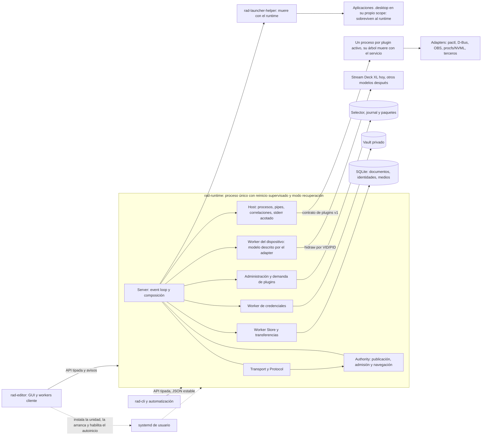

# Arquitectura de RAD

Norma de la arquitectura objetivo. Los motivos de cada decisión están en los
[ADR](adr/); lo que falta implementar, en el [plan por fases](roadmap.md); cómo se
comporta y habla la interfaz, en [ux.md](ux.md). Un cambio que contradiga este
documento o un ADR necesita un ADR nuevo.

«Base estable» es todo lo que no es presentación: dominio, autoridad, runtime,
persistencia, transporte, contratos, alojamiento de plugins y adapters esenciales.
Estable no quiere decir inmutable: un cambio observable declara su compatibilidad
y prueba el contrato.

## Procesos y dueños

- **rad-runtime:** proceso sin GUI y única autoridad de configuración, ejecución,
  navegación y dispositivo; único dueño de hidraw ([ADR 0001](adr/0001-runtime-unico-y-procesos.md)).
  Corre como servicio systemd de usuario que gestiona el editor
  ([ADR 0012](adr/0012-servicio-gestionado-por-el-editor.md)). Si no puede abrir la
  configuración, entra en modo recuperación ([ADR 0011](adr/0011-salidas-y-modo-recuperacion.md)).
- **rad-editor y rad-cli:** clientes del socket local; observan y piden
  ([ADR 0010](adr/0010-api-de-clientes.md)).
- **Plugins:** un proceso por plugin activo, arrancado por demanda; nada de lo que
  lancen sobrevive al runtime ([ADR 0013](adr/0013-limpieza-de-procesos.md)).
- **rad-launcher-helper:** mantiene GIO fuera del runtime y lanza cada aplicación en
  su propio scope, de modo que las aplicaciones sobreviven al runtime.
- **Datos:** SQLite local con publicación transaccional y un vault de credenciales
  privado.

Un proceso separado contiene caídas y errores de protocolo; no es un sandbox
([ADR 0009](adr/0009-confianza-en-plugins.md)).

## Principios

Una propuesta que viole uno necesita una decisión registrada.

### Estabilidad

- **E1 · Una autoridad y un dueño por estado.** El runtime decide; los clientes
  observan y piden.
- **E2 · Ningún error pierde su causa.** Cada error llega al cliente con un código
  preciso; el editor lo traduce.
- **E3 · Timeout, cancelación y terminación son cosas distintas,** y cada trabajo
  residual tiene un dueño explícito ([ADR 0014](adr/0014-residual-de-plugins-en-el-host.md)).
- **E4 · Reinicio seguro.** El estado durable y la reconciliación al arrancar hacen
  seguro reiniciar, sin bucles de reinicio ([ADR 0011](adr/0011-salidas-y-modo-recuperacion.md)).
- **E5 · Sin repetición de acciones** tras reconexión, reinicio o caída de un plugin.
- **E6 · Contención de plugins** frente a fallos y abusos dentro del protocolo
  ([ADR 0009](adr/0009-confianza-en-plugins.md)).
- **E7 · Contratos públicos con una sola definición,** versión y pruebas en ambos
  lados: contrato de plugins, API de clientes, salida de `rad-cli` y formatos.

### Eficiencia

- **EF1 · Eventos en vez de sondeos,** como preferencia: UI y frescura de visuales.
  Excepción registrada: con el deck ausente se sigue sondeando cada 500 ms, porque
  hacerlo por eventos complica más de lo que ahorra.
- **EF2 · El coste crece con el cambio, no con la historia.**
- **EF3 · Recursos por demanda.** Plugins dormidos sin proceso; lectores compartidos
  y liberados con el último consumidor.
- **EF4 · Optimizar contra presupuestos medidos,** con un perfil reproducible.

### Orden

- **O1 · Capas con dependencias solo hacia abajo,** verificadas por un test.
- **O2 · La base estable crece solo por decisión registrada.** La UI y los plugins
  crecen en sus capas.
- **O3 · La presentación no vive en el dominio.** Idioma, tema y preferencias son
  del editor; el runtime entrega códigos, no prosa para el usuario.
- **O4 · Protocolos tipados,** sin cadenas interpretadas a mano en varios sitios.
- **O5 · Los contratos para terceros se documentan donde se buscan.** El de plugins,
  en `KroxiDev/rad-plugins`; la API de clientes y los formatos, en este repo.
- **O6 · Tres tipos de ajustes, cada uno con su dueño**
  ([ADR 0005](adr/0005-tres-tipos-de-ajustes.md)).

### Simplicidad para el usuario

El usuario ve el funcionamiento, no el mecanismo: principios S1–S5 en [ux.md](ux.md).

## Capas

| Capa | Paquete | Responsabilidad | Dependencias locales permitidas |
|---|---|---|---|
| 0 · Formatos y contratos puros | `rad-wire` | Framing, envelope y límites de representación | ninguna |
| 0 | `rad-plugin-contract` | Manifest, esquemas, mensajes, versiones y credenciales del protocolo de plugins | wire |
| 0 | `rad-plugin-package` | Framing RADP y validación estructural del binario | plugin-contract |
| 0 | `rad-media` | Normalización y validación de imágenes | ninguna |
| 0 | `rad-api` (pendiente) | Peticiones, respuestas, vistas, avisos y códigos de error de la API de clientes | ninguna |
| 1 · Dominio | `rad-core` | Configuración, identidad, permisos, entrada, admisión y ejecución puras | ninguna |
| 1 | `rad-codec` | Documento JSON de configuración, acotado | core |
| 2 · Aplicación | `rad-authority` | Publicación, historial, navegación, vistas y bindings de plugins | plugin-contract, core, codec |
| 3 · Adapters | `rad-store` | SQLite, identidades, revisiones, medios, recuperación y GC | core, codec, media |
| 3 | `rad-credentials` | Vault cifrado privado y reconciliación | ninguna |
| 3 | `rad-package` | Copias: exportar, restaurar y staging | core, codec, media |
| 3 | `rad-plugin-manager` | Preparación, descarga, selector durable y journal | plugin-contract, plugin-package |
| 3 | `rad-plugin-host` | Procesos, handshake, pipes, generaciones y residuales | plugin-contract |
| 3 | `rad-transport` | Sockets, origen confiable, crédito y readiness | wire |
| 3 | `rad-deck` | Dueño del dispositivo, descriptor de modelo, entrada y salida | media |
| 3 | `rad-launcher` | Adapter y helper de aplicaciones de escritorio | core, media |
| 4 · Traducción y composición | `rad-protocol` | API de clientes ↔ interface de aplicación | plugin-contract, authority, core, wire, api |
| 4 | `rad-runtime` | Composición, event loop, efectos y ajustes de la máquina; único que compone adapters | todas las anteriores |
| 5 · Clientes | `rad-client` | Conexión, consultas consistentes y CLI | wire, api |
| 5 | `rad-editor` | Presentación, catálogos de textos, preferencias, borradores y workers cliente | plugin-contract, client, api |
| Extensiones (workspace `plugins/`) | `rad-plugin-sdk` | Handshake, framing, correlación, respuestas, suscripciones y límites | plugin-contract ([ADR 0007](adr/0007-contrato-de-plugins-v1.md)) |
| Extensiones | plugins oficiales | Semántica de cada integración | SDK |

Reglas:

1. Un paquete depende solo de capas inferiores o de los paquetes de su capa que la
   tabla lista: `rad-plugin-contract → rad-wire` y `rad-plugin-package →
   rad-plugin-contract` en la capa 0, `rad-codec → rad-core` en la 1,
   `rad-runtime → rad-protocol` en la 4 y `rad-editor → rad-client` en la 5.
2. Las capas 0 a 2 no dependen de crates de I/O (`rusqlite`, `mio`, `libc`, `ureq`,
   `gio`, `glib`, `eframe`). `rad-core` no tiene dependencias.
3. Los adapters no dependen entre sí; solo `rad-runtime` los compone.
4. Los clientes dependen solo de contratos y de `rad-client`, nunca del dominio, la
   autoridad ni los adapters.
5. Las extensiones dependen solo del SDK y del contrato.

Un test de arquitectura lee los manifiestos y falla si una dependencia normal no
figura en la tabla; las reglas 2 a 4 se comprueban además como invariantes. Una
dependencia nueva exige editar esta tabla, es decir, registrar una decisión. Se
prefirió esta lista explícita a dividir las capas en subcapas, que añadirían
numeración sin información.

## Dónde vive cada cambio

| Cambio | Dónde | Condición de aceptación |
|---|---|---|
| Layout, panel, borrador, feedback | Editor | Usa vistas y avisos de la API, sin crear otra autoridad; cumple [ux.md](ux.md) |
| Texto visible o traducción | Catálogos del editor | Todo texto sale del catálogo; el runtime no redacta prosa |
| Vista nueva para la UI | `rad-api`, `rad-protocol` y una consulta en Authority | Tipada, coherente por revisión y acotada |
| Plugin nuevo | Workspace de plugins o repo del autor | Pasa `rad-plugin-check`; sin ramas específicas en runtime ni editor |
| Capacidad nueva del contrato de plugins | `rad-plugin-contract`, host y SDK | Negociada como capacidad; especificación, vectores y arnés actualizados |
| Preferencia del editor | Editor | Fuera de `rad-core` y de las copias |
| Ajuste de la máquina | Runtime local | Fuera de la configuración del deck y de las copias |
| Ajuste de un plugin | Esquema `settings` del manifest; valores en la configuración del deck | Viaja en las copias; los secretos, en credenciales |
| Modelo de dispositivo nuevo | `rad-deck` | Descriptor de modelo; el dominio cambia solo si hay controles nuevos |
| Cambio de formato | Store, codec o package | Atomicidad, migración hacia adelante, evidencia preservada e importador con golden real |
| Bug o refactor interno | Módulo dueño | Conserva la interface observable o declara el cambio; prueba la composición entre dueños |
| Sandbox, firma u otras plataformas | Ampliación de alcance | Pedido explícito del usuario |

## Complejidad deliberada

Estas piezas parecen simplificables y no lo son:

- **Pureza y efectos.** `rad-core` sin dependencias y Authority sin I/O dan pruebas
  deterministas. Las precondiciones de una interface se verifican también en la
  composición real.
- **Durabilidad conservadora.** La reconciliación con escritura real, el hold de
  evidencia corrupta y Uncertain como estado propio protegen la recuperación. Se
  simplifica lo que ve el usuario, no la semántica.
- **Trabajo bloqueado acotado.** El downloader conserva ACTIVE hasta que termina su
  hilo real, aunque el coordinador ya haya respondido.
- **Plugins oficiales.** Metrics: un solo lector, canales acotados y lector terminal
  sin reemplazo. Audio: `pactl` explícito, `env_clear`, PDEATHSIG y kill+wait, con un
  monitor compartido. Media: leases débiles, epochs y límites de carátulas. OBS:
  transporte retirado con el último consumidor y sin replay al reconectar.
- **Deck.** Un hilo propietario y la bandera LIVE evitan reemplazos crecientes;
  O_NONBLOCK, O_NOFOLLOW y comprobaciones de char-device, ioctl y lock.
- **Launcher.** Helper propio que lanza archivos `.desktop`; las órdenes por IPC
  nunca son un shell.

## Checklist para cambios en la base estable

- [ ] Dueño del estado y del efecto identificados; sin autoridad paralela ni setter genérico.
- [ ] La tabla de capas se respeta y el test de arquitectura pasa.
- [ ] Precondiciones temporales y clasificación Applied, NotApplied o Unknown
      documentadas; cada error llega al cliente con su código.
- [ ] Timeout, cancelación y terminación distintos en cada módulo y en su
      integración; el dueño del residual es explícito.
- [ ] Colas, créditos, payloads, deadlines y residuales acotados, con política de desborde.
- [ ] Identidad, permisos actuales frente a snapshot, historial y raíces de GC
      preservados; los contadores de identidad nunca retroceden.
- [ ] Cada error nuevo tiene su clase: limpia, bloqueante, recuperación, inesperada
      o contenida ([ADR 0011](adr/0011-salidas-y-modo-recuperacion.md)).
- [ ] Cada ajuste nuevo tiene su tipo: deck, máquina o editor
      ([ADR 0005](adr/0005-tres-tipos-de-ajustes.md)).
- [ ] Compatibilidad de contrato o formato declarada cuando cambia el comportamiento
      externo; vectores y especificación actualizados.
- [ ] Lo que no se puede verificar en el sandbox o sin hardware se informa sin extrapolar.

## Decisiones registradas

| ADR | Decisión |
|---|---|
| [0001](adr/0001-runtime-unico-y-procesos.md) | Un runtime único como autoridad, clientes por socket y un proceso por plugin |
| [0002](adr/0002-identidades-sobre-lo-vigente.md) | El límite de identidades se aplica a lo vigente, con contadores persistentes |
| [0003](adr/0003-copias-portables.md) | Copias portables entre instalaciones y regla de IDs |
| [0004](adr/0004-evolucion-de-formatos.md) | Corte limpio del formato e importadores por versión |
| [0005](adr/0005-tres-tipos-de-ajustes.md) | Tres tipos de ajustes; los de los plugins viajan en las copias |
| [0006](adr/0006-dispositivo-por-modelo.md) | Dispositivo descrito por modelo, sin tener en cuenta otros programas |
| [0007](adr/0007-contrato-de-plugins-v1.md) | Contrato de plugins v1: capacidades y una sola definición |
| [0008](adr/0008-frescura-declarada.md) | Frescura declarada y renovada por quien observa la fuente |
| [0009](adr/0009-confianza-en-plugins.md) | Confianza en plugins y estándar de compatibilidad |
| [0010](adr/0010-api-de-clientes.md) | API de clientes tipada con avisos |
| [0011](adr/0011-salidas-y-modo-recuperacion.md) | Clases de salida, reinicio sin bucles y modo recuperación |
| [0012](adr/0012-servicio-gestionado-por-el-editor.md) | Servicio systemd gestionado por el editor |
| [0013](adr/0013-limpieza-de-procesos.md) | Limpieza de procesos: scopes para las aplicaciones y `KillMode=mixed` |
| [0014](adr/0014-residual-de-plugins-en-el-host.md) | El residual de un plugin vencido pasa al Host |
